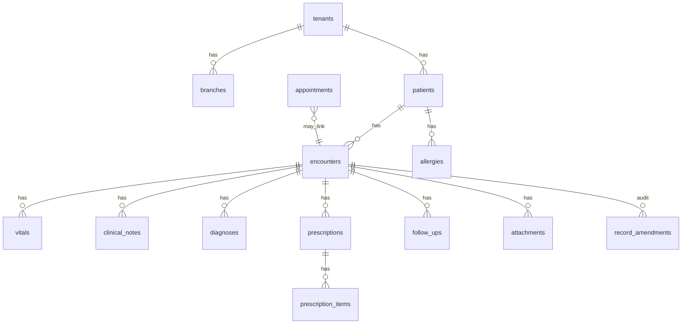

# Clinical data model proposal (pre–Batch 2)

**Status:** Design for review — **no implementation in this docs PR.**

Goal: extensible EMR for general OPD + dental without duplicating entire specialty templates.

---

## 1. Principles

- **Encounter-centric:** every clinical interaction links to an `encounter` (visit).
- **Draft → finalized:** clinicians edit drafts; finalize locks core fields; amendments append.
- **Tenant-scoped:** all clinical tables include `tenant_id`; RLS on PostgreSQL.
- **Mobile-ready:** JSON API resources map 1:1 to tables; PDFs generated server-side.
- **Dental extensions:** tooth chart / procedure codes as optional JSON or child table — not a second EMR.

---

## 2. Entity relationship (logical)

---

## 3. Core tables (proposed)

| Table | Purpose | Key fields |
|-------|---------|------------|
| `branches` | Enterprise multi-location | `tenant_id`, `name`, `address`, `timezone`, `is_default` |
| `encounters` | Visit / consultation | `patient_id`, `doctor_id`, `appointment_id?`, `status` draft\|finalized, `started_at`, `finalized_at`, `chief_complaint` |
| `vitals` | Observations | `encounter_id`, `code` (BP, weight, …), `value`, `unit`, `recorded_at` |
| `clinical_notes` | SOAP / free text | `encounter_id`, `section`, `body`, `author_id` |
| `diagnoses` | ICD/SNOMED optional | `encounter_id`, `code`, `description`, `is_primary` |
| `prescriptions` | Rx header | `encounter_id`, `status`, `printed_at`, `pdf_object_key?` |
| `prescription_items` | Line items | `drug_name`, `dose`, `frequency`, `duration`, `instructions` |
| `allergies` | Patient-level | `patient_id`, `substance`, `severity`, `notes` |
| `follow_ups` | Return visit plan | `encounter_id`, `due_date`, `instructions`, links to `reminder_jobs` |
| `attachments` | Files | `encounter_id?`, `patient_id`, `storage_key`, `content_type`, `kind` |
| `record_amendments` | Legal/clinical audit | `entity_type`, `entity_id`, `reason`, `before_json`, `after_json`, `author_id` |

### Existing tables (evolve, don’t duplicate)

| Current | Evolution |
|---------|-----------|
| `patients.prescription_url` | Deprecated in favor of `attachments` + `prescriptions`; keep for migration |
| `patients.notes`, `chief_complaint` | Snapshot at registration; encounter holds visit-specific complaint |
| `appointments` | Add optional `encounter_id`; status drives queue |
| `reminder_jobs` | Add `follow_up_id` FK |

---

## 4. Permissions (server-enforced)

| Role | Encounters | Finalize | Amend | Prescriptions | Billing |
|------|------------|----------|-------|---------------|---------|
| owner | CRUD | yes | yes | yes | yes |
| doctor | CRUD own | yes | request | yes | read |
| reception | create draft, schedule | no | no | no | create payments |
| staff | read limited | no | no | no | read |

Map to expanded RBAC beyond today’s owner/staff.

---

## 5. API sketch (for OpenAPI)

- `GET/POST /api/clinic/patients/:id/encounters`
- `PATCH /api/clinic/encounters/:id` (draft only)
- `POST /api/clinic/encounters/:id/finalize`
- `POST /api/clinic/encounters/:id/amendments`
- `GET /api/clinic/encounters/:id/prescription.pdf`

---

## 6. Dental workflow notes

- **Catalog items** (existing) remain procedure/service catalog.
- **Tooth chart:** optional `encounters.dental_chart_json` for Professional+; validate schema server-side.
- **Imaging:** `attachments` with `kind=radiograph`.

---

## 7. Acceptance criteria (design sign-off)

- [ ] Owner approves entity list and draft/finalize rules
- [ ] Migration path from flat `patients.prescription_url` documented
- [ ] Batch 2 scope limited to MVP encounter + Rx lines + PDF (no pharmacy inventory)
